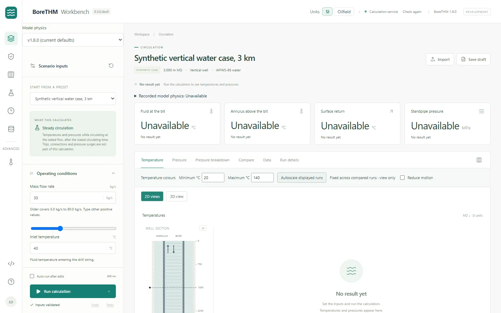
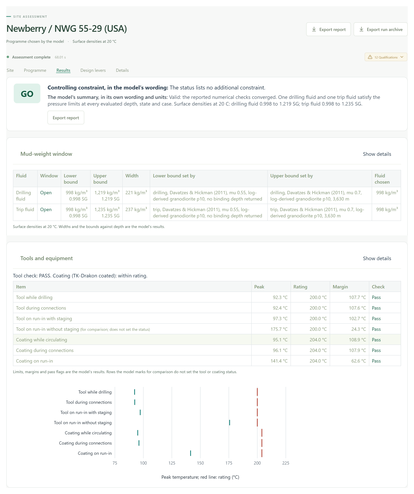
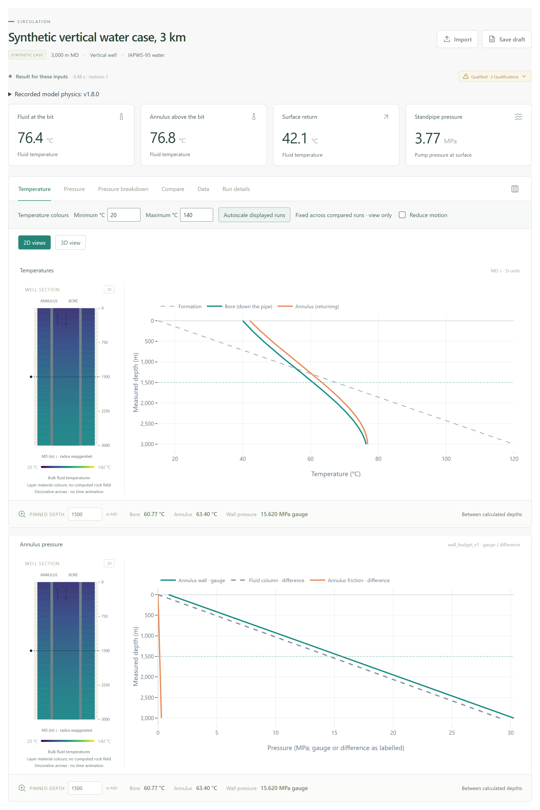
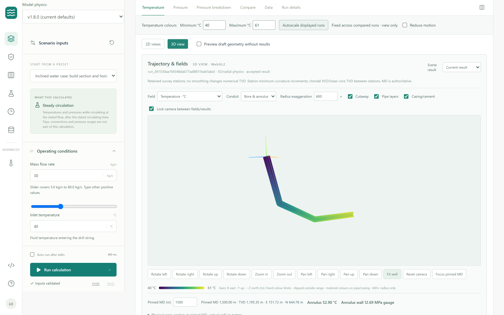
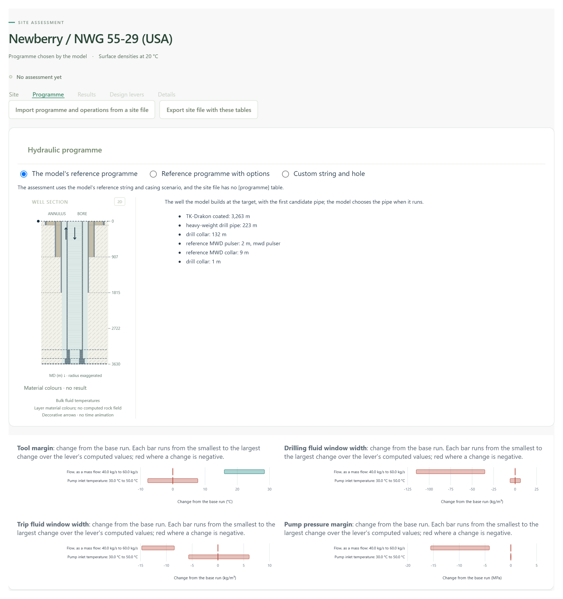
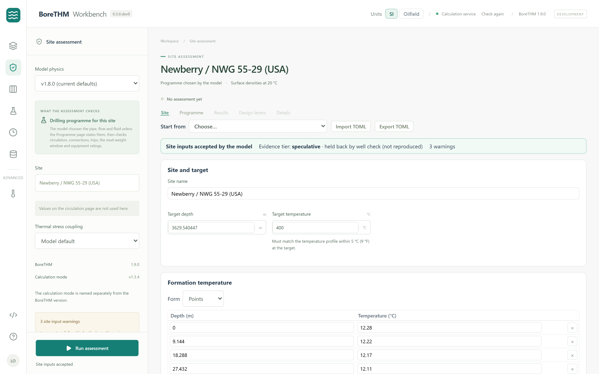
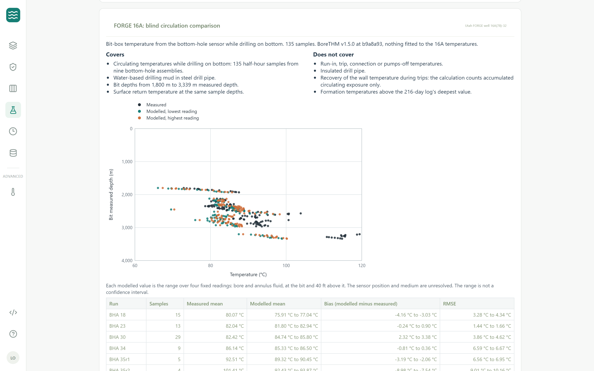
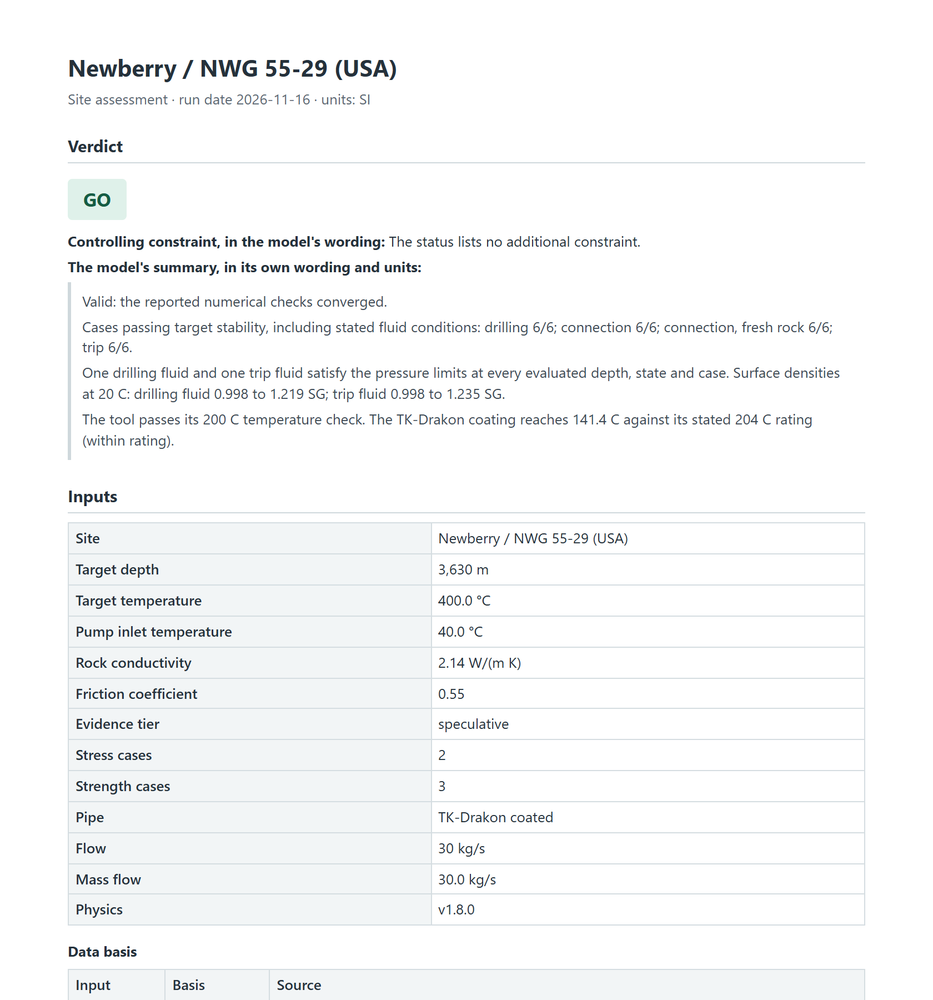

# BoreTHM Workbench

BoreTHM Workbench is a local, single-user browser application for running BoreTHM calculations and inspecting their results.



It uses the [BoreTHM model package](https://github.com/ldocallaghan/BoreTHM); the [model documentation](https://ldocallaghan.github.io/BoreTHM/) describes the equations and input data.

## What you can do

### Assessment results

An assessment opens on a results page built from the evaluator result: the verdict and controlling constraint, the mud-weight window with the binding depth of each bound, each tool and coating peak temperature against its rating, the stability verdicts at the target and the standpipe pressure. The verdict text is labelled as the model's own wording. Qualifications appear as plain sentences.



### Circulation runs

A circulation run calculates temperatures and pressures while circulating at the stated flow, after the stated circulating time. Choose SI or oilfield units in the top bar; scenarios, archives and the model hold SI values. Parameter sweeps repeat a declared set of circulation inputs, with at most 25 cases.



### The well view

A well survey describes the path through the ground. The 3D view draws the well along that path, coloured by the bore or annulus temperature or the annulus wall pressure, with the pipe layers and casing.



### Programme and design levers

A Programme page states the drilling programme: the string and casing, and any of the pipe, flow, limits, timings, rate of penetration and fluids the model otherwise chooses. Each operating choice is either chosen by the model, with its rule and default, or stated with a basis and a source.

A Design levers page then runs computed cases that change one or two of those inputs and shows which change the verdict. It shows a table of verdicts, controlling constraints, margins and window widths, and a tornado chart of the change of each margin from the base run.



### Site editor

A site editor creates BoreTHM site files from a form: target, temperature profile, stress cases or the transition rule, strength cases, rock properties and provenance. It checks every change with the model's `validate_site`, shows each warning beside its field, reports the evidence tier, and imports and exports TOML.



### Field comparisons

The Field comparisons page shows the FORGE 16A and 16B circulation comparisons published with BoreTHM 1.8.0, with their bias and RMSE and what each covers. Each run lists its inputs outside the conditions those comparisons cover. The application makes no field comparison of its own.



### Reports

Completed circulation runs and assessments export a self-contained HTML report that prints to A4 or Letter. The same run and unit choice give the same bytes.



## Install and run

From a checkout, with Python 3.11 to 3.14 and Node.js 24 available:

```text
python -m venv .venv
python -m pip --python .venv install -r requirements-lock.txt
python -m pip --python .venv install --no-deps -e .
npm --prefix frontend ci
npm --prefix frontend run build
.venv/Scripts/borethm-workbench prepare
.venv/Scripts/borethm-workbench serve
```

On Linux use `.venv/bin/borethm-workbench` for the last two commands. Open the local address printed at start-up. Preparation generates the model's water-property table and can take several minutes. Use `--data-dir` on both commands to select a persistent data directory. See [getting started](docs/getting-started.md) for the installation checks and data selection.

## Scope and limits

Windows and Ubuntu are the supported desktop platforms. The service listens on the local machine and is intended for one user.

New scenarios use schema 1.1 and current physics (`v1.8.0`). The physics selector also offers previous defaults (`v1.7.0`). Run details and exports record the model's resolved settings.

Wall and tool histories, scheduled interventions and checkpoint branching are under Advanced: these research tools use prescribed local boundary conditions.

Named tool classes can use generic pressure-loss allowances; enter the maker's figure where known.

See [scope and limits](docs/scope-and-limits.md) for the test evidence and numerical comparison tolerances.

## Licence and citation

The code is licensed under Apache-2.0. [NOTICE](NOTICE) records data attribution and frontend library licences. Cite this application using [CITATION.cff](CITATION.cff), and cite the underlying model as BoreTHM, DOI [10.5281/zenodo.23549104](https://doi.org/10.5281/zenodo.23549104).
